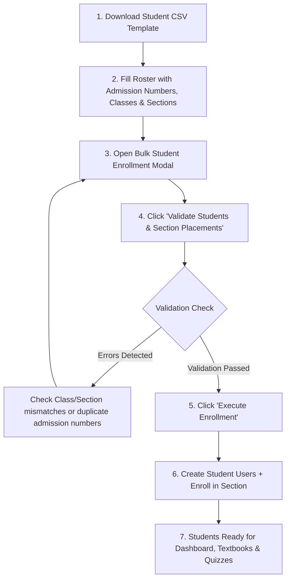

# Bulk Student Import & Enrollment Specification Guide

## Nepal Digital Education Ecosystem (नेपाल डिजिटल शिक्षा प्रणाली)
**Target Users:** School Administrators, Exam Officers, Academic Registrars  
**Platform Version:** 2.0 (MERN Architecture + CDC Nepal Integrated)

---

## 1. Overview
The Bulk Student Import & Enrollment engine enables schools to register and enroll entire classes and sections of students in a single batch operation. The engine verifies institutional classes, matches section names, ensures admission number uniqueness, sets up student user accounts, and establishes academic enrollments linked to the active academic session.

---

## 2. CSV File Structure & Headers

### Mandatory Header Row:
```csv
admissionNumber,rollNumber,fullName,fullNameNepali,className,sectionName,gender,guardianName,guardianPhone,guardianRelation
```

### Sample CSV Content:
```csv
admissionNumber,rollNumber,fullName,fullNameNepali,className,sectionName,gender,guardianName,guardianPhone,guardianRelation
ADM-2081-001,1,Aarav Sharma,आरव शर्मा,Class 10,A,MALE,Kishor Sharma,9841000001,Father
ADM-2081-002,2,Bipana Chaudhary,बिपना चौधरी,Class 10,A,FEMALE,Sundar Chaudhary,9841000002,Father
ADM-2081-003,3,Chiranjibi Pokharel,चिरन्जीवी पोखरेल,Class 10,A,MALE,Ganesh Pokharel,9841000003,Father
ADM-2081-004,1,Deepak Thapa,दीपक थापा,Class 10,B,MALE,Bhim Bahadur Thapa,9841000004,Father
ADM-2081-005,2,Elina Shrestha,एलिना श्रेष्ठ,Class 10,B,FEMALE,Prakash Shrestha,9841000005,Father
ADM-2081-006,1,Gaurav KC,गौरव केसी,Class 9,A,MALE,Dan Bahadur KC,9841000006,Father
```

---

## 3. Column Data Specifications & Validation Rules

| Column | Data Type | Mandatory? | Validation Rule | Example |
|---|---|---|---|---|
| `admissionNumber` | String | **Yes** | Permanent school registration number. Must be unique per school session. | `ADM-2081-001` |
| `rollNumber` | Integer | **Yes** | Positive integer $\ge 1$. Section classroom roll number. | `1` |
| `fullName` | String | **Yes** | 2 to 100 characters legal English name. | `Aarav Sharma` |
| `fullNameNepali` | String | Optional | Devanagari Unicode script. | `आरव शर्मा` |
| `className` | String | **Yes** | Must match an existing class in school (e.g. `Class 10`, `10`). | `Class 10` |
| `sectionName` | String | **Yes** | Must match an existing section under that class (e.g. `A`, `B`). | `A` |
| `gender` | Enum | Optional | `MALE`, `FEMALE`, or `OTHER`. | `MALE` |
| `guardianName` | String | Optional | Full name of parent or legal guardian. | `Kishor Sharma` |
| `guardianPhone` | String | Optional | 10-digit mobile contact number for SMS and notifications. | `9841000001` |
| `guardianRelation` | String | Optional | Relationship (e.g. `Father`, `Mother`, `Guardian`). | `Father` |

---

## 4. Enrollment Workflow: Step-by-Step



---

## 5. Account Security & Login Credentials
1. **Student Username Generation:** Formatted for easy distribution:
   ```
   stu_<firstname>_<rollNumber>_<randomSuffix>
   Example: stu_aarav_1_482
   ```
2. **Default Password:** Initialized with the secure default password:
   ```
   Student@2081
   ```
   *(Hashed with bcrypt over 10 salt rounds; never stored in plaintext).*
3. **Student Profile:** Automatic link between User account, StudentEnrollment document, section subjects, and exam grade books.
4. **Tenant Isolation:** Enrolled students strictly inherit the feature access and curriculum policies of their school and section.

---

## 6. Common Troubleshooting & Error Resolution

| Error Message | Root Cause | Solution |
|---|---|---|
| `Admission number is required` | Admission number column empty. | Enter unique student registration number. |
| `Class 'Class 10' does not exist in this institution` | Class has not been configured in Academic Structure. | Create the class first in *Classes & Academic Structure* tab. |
| `Section 'B' not found in Class 10` | Section B does not exist for this class. | Add Section B under Class 10 before uploading. |
| `Duplicate admission number in file` | Two rows in the CSV share the same admission number. | Correct duplicate rows. |
| `Admission number already enrolled in current year` | Student is already active in database for session 2081/2082. | Check existing student roster. |
| `Roll number must be a positive number` | Roll number was 0, negative, or non-numeric. | Enter valid integer (e.g. 1, 2, 3...). |

