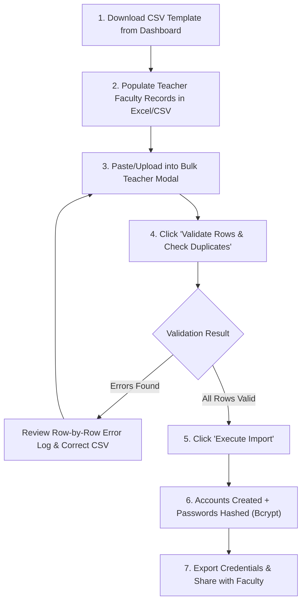

# Bulk Teacher Import Specification & User Guide

## Nepal Digital Education Ecosystem (नेपाल डिजिटल शिक्षा प्रणाली)
**Target Users:** School Administrators, HR Coordinators, IT System In-Charges  
**Platform Version:** 2.0 (MERN Architecture + CDC Nepal Integrated)

---

## 1. Overview
The Bulk Teacher Import engine allows school and college administrators to quickly onboard their entire teaching staff using standard CSV (Comma-Separated Values) or Excel files. The engine performs strict pre-flight validation, detects email and username collisions, encrypts default passwords using bcrypt, and provides an actionable error report before any account is created.

---

## 2. CSV File Structure & Headers

### Mandatory Header Row:
```csv
fullName,fullNameNepali,email,phone,gender,qualification,specialization
```

### Sample CSV Content:
```csv
fullName,fullNameNepali,email,phone,gender,qualification,specialization
Ram Bahadur Thapa,राम बहादुर थापा,ram.thapa@school.edu.np,9841234567,MALE,M.Sc. Mathematics,Secondary Mathematics
Sita Devi Sharma,सीता देवी शर्मा,sita.sharma@school.edu.np,9851234568,FEMALE,M.Ed. English,English Literature
Hari Prasad Dahal,हरि प्रसाद दाहाल,hari.dahal@school.edu.np,9861234569,MALE,M.Sc. Physics,General Science
Gita Kumari Adhikari,गीता कुमारी अधिकारी,gita.adhikari@school.edu.np,9841987654,FEMALE,M.A. Nepali,Compulsory Nepali
Kiran Shrestha,किरण श्रेष्ठ,kiran.shrestha@school.edu.np,9851456789,MALE,B.Sc. Computer Science,Computer & IT
```

---

## 3. Column Data Specifications & Validation Rules

| Column | Data Type | Mandatory? | Validation Rule | Example |
|---|---|---|---|---|
| `fullName` | String | **Yes** | 2 to 100 characters, legal English name. | `Ram Bahadur Thapa` |
| `fullNameNepali` | String | Optional | Devanagari Unicode characters. | `राम बहादुर थापा` |
| `email` | String | **Yes** | Valid RFC email address. Must be globally unique in database. | `ram.thapa@school.edu.np` |
| `phone` | String | Optional | 10-digit Nepal mobile number or local landline. | `9841234567` |
| `gender` | Enum | Optional | `MALE`, `FEMALE`, or `OTHER` (case-insensitive). | `MALE` |
| `qualification` | String | Optional | Academic degrees attained. | `M.Sc. Mathematics` |
| `specialization` | String | Optional | Primary subject area expertise. | `Secondary Mathematics` |

---

## 4. Import Workflow: Step-by-Step



---

## 5. Account Security & Login Credentials
1. **Username Generation:** Automatically derived from the teacher's email prefix (e.g. `ram.thapa` or `ram_thapa`). If duplicate collisions exist, a random unique numeric suffix is appended.
2. **Default Password:** Every imported teacher account is initialized with the standard default password:
   ```
   Teacher@2081
   ```
   *(Hashed with bcrypt over 10 salt rounds before storage; never saved in plain text).*
3. **First-Time Password Change:** Teachers are prompted to set a personalized private password upon their initial sign-in.
4. **Tenant Isolation:** Every created teacher account is strictly bound to the `institutionId` of the uploading administrator. They cannot view or teach classes in other institutions.

---

## 6. Common Troubleshooting & Error Resolution

| Error Message | Root Cause | Solution |
|---|---|---|
| `Full name is required` | Row is missing teacher name. | Enter full legal name. |
| `Email address is required` | Missing email field. | Add valid email address. |
| `Invalid email address format` | Typo in email (e.g. `ram.thapa@com`). | Ensure email includes `@` and valid domain. |
| `Duplicate email in uploaded file` | Same email listed multiple times in CSV. | Remove duplicate row. |
| `Email is already registered in platform` | Email already exists in User collection. | Use an alternative institutional email. |
| `No valid teacher records detected` | Uploaded file contains only header row. | Ensure at least 1 data row is populated. |

