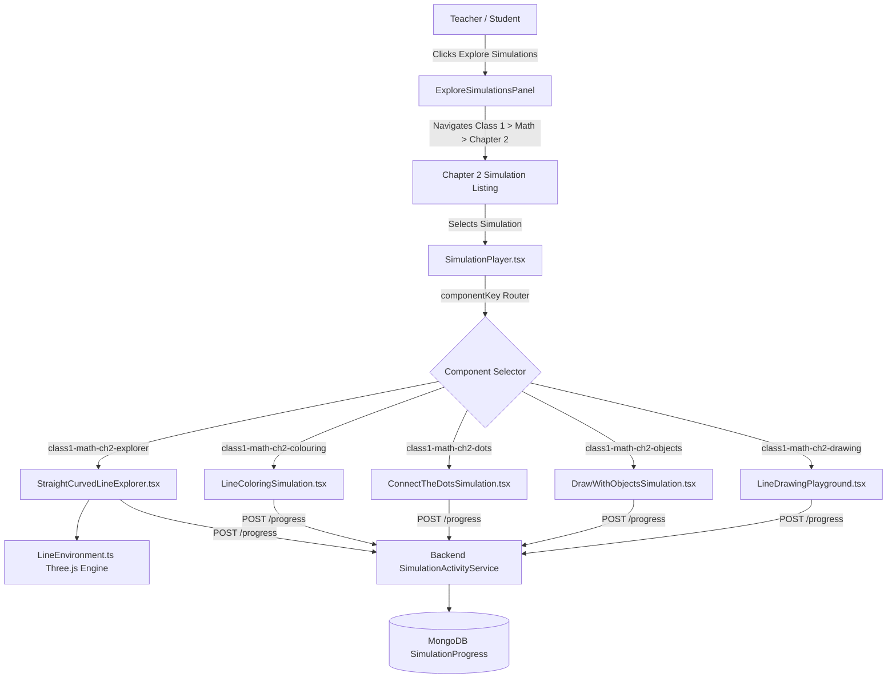

# Class 1 Mathematics Chapter 2: Lines (रेखाहरू) - 3D & Frontend Architecture

## 1. System Architecture Overview



---

## 2. Three.js Scene Engine (`LineEnvironment.ts`)

### Lighting & Rendering Pipeline
- **Renderer:** `THREE.WebGLRenderer` with `antialias: true`, `powerPreference: 'high-performance'`, and ACESFilmic tone mapping.
- **Shadows:** Soft PCF shadow mapping (`renderer.shadowMap.type = THREE.PCFSoftShadowMap`).
- **Camera:** `PerspectiveCamera` (FOV: 45°, near: 0.1, far: 1000) with animated smooth lerping transitions between observation viewpoints.
- **Lighting Setup:**
  - Ambient Light: `THREE.AmbientLight(0xfff8e7, 0.7)` warm daylight.
  - Directional Sun: `THREE.DirectionalLight(0xffffff, 1.2)` positioned at `(20, 35, 20)` casting crisp shadows.
  - Hemisphere Sky/Ground Light: Sky `#bae6fd`, Ground `#bbf7d0`.

### Raycasting & Interactivity
- Interactive 3D objects are tagged in an `interactiveObjects` array with metadata:
  ```ts
  object.userData = {
    id: 'straight_road',
    nameEn: 'Straight Village Road',
    nameNp: 'सीधा गाउँको बाटो',
    type: 'straight',
    descriptionNp: 'यो बाटो कतै नमोडी सीधा गएको छ।',
    descriptionEn: 'This road continues forward without bending.'
  };
  ```
- Mouse/touch pointer events map through `THREE.Raycaster`. When a ray intersects an item, its emissive material pulsates with a glowing highlight halo.

---

## 3. Dynamic Catenary Rope Physics
In Simulation 01, the rope stretches interactively between two wooden posts. The geometry is updated dynamically via Catmull-Rom spline curves:
```ts
const sag = (1 - tension) * 1.8; // At tension = 1, sag = 0 (straight line)
const curve = new THREE.CatmullRomCurve3([
  new THREE.Vector3(-2, 1.5, 0),
  new THREE.Vector3(0, 1.5 - sag, 0),
  new THREE.Vector3(2, 1.5, 0)
]);
ropeMesh.geometry.dispose();
ropeMesh.geometry = new THREE.TubeGeometry(curve, 32, 0.05, 8, false);
```

---

## 4. UI Overlay & State Management
- Pure React 19 component state (`useState`, `useRef`, `useEffect`).
- Dual-language state (`language: 'np' | 'en'`) with persistent bilingual audio narration.
- Zero external CSS bloat—inline styles with child-friendly color palettes (`#0284c7`, `#10b981`, `#f59e0b`, `#dc2626`).
- Responsive viewports adapting automatically to tablets, mobile touchscreens, and desktop monitors.

