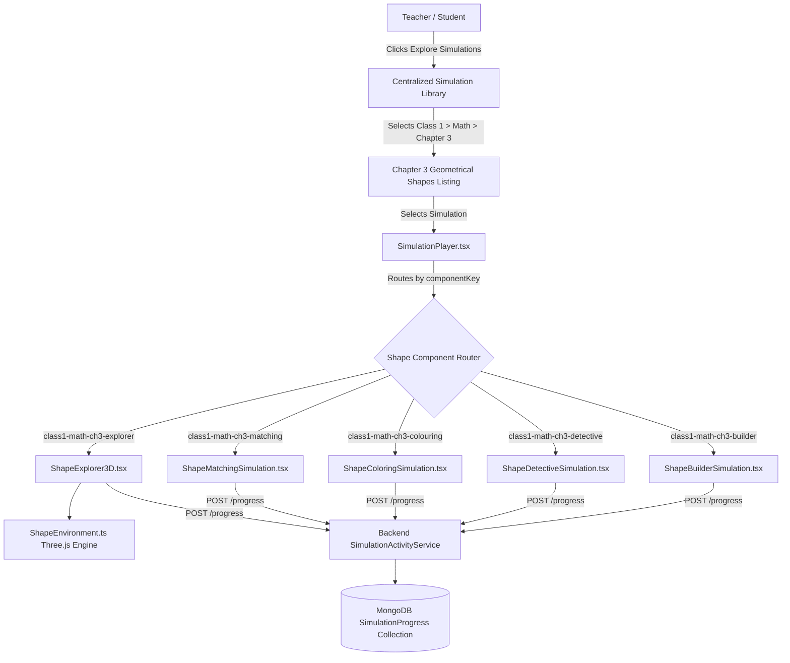

# Class 1 Mathematics Chapter 3: Geometrical Shapes (ज्यामितीय आकारहरू) - 3D Architecture

## 1. High-Level System Architecture



---

## 2. 3D WebGL Pipeline (`ShapeEnvironment.ts`)

### Camera, Renderer & Fog
- **Renderer:** `THREE.WebGLRenderer` with `antialias: true`, `powerPreference: 'high-performance'`, ACESFilmic tone mapping, and soft PCF shadow maps.
- **Camera:** `PerspectiveCamera` (FOV: 45°, aspect: container ratio, near: 0.1, far: 100). Default view position `(0, 4, 9)` tilted at the central circular podium stage.
- **Atmospheric Fog:** `THREE.FogExp2(0xf0fdf4, 0.025)` blending distant background softly into the pastel green playground theme.

### Lighting & Shadow Setup
- **Ambient Light:** Warm white light (`0xffffff`, intensity `0.85`) ensuring all faces are clearly visible from any viewing angle.
- **Directional Sunlight:** `THREE.DirectionalLight(0xfff7ed, 1.3)` positioned at `(8, 16, 10)` casting realistic shadows onto the circular podium stage.
- **Hemisphere Bounce:** Sky color `#bae6fd`, ground bounce `#bbf7d0`.

---

## 3. Raycasting & Object Rotation

### Interactive Object Tagging
Each 3D object group is tagged with metadata in its `userData`:
```ts
obj.mesh.userData = {
  interactiveId: obj.id,
  shapeObject: {
    id: 'clock',
    nameEn: 'Wall Clock',
    nameNp: 'भित्ते घडी',
    category: 'circle',
    categoryNp: 'वृत्त',
    descriptionNp: 'यो भित्ते घडीको मुख गोलो वृत्त आकारको हुन्छ।',
    descriptionEn: 'The face of this wall clock has a circular shape (वृत्त).'
  }
};
```

### Pointer Raycasting & Drag Rotation
- When user clicks or taps the canvas, `THREE.Raycaster` projects through the camera to intersect meshes.
- Dragging horizontally applies real-time delta rotation (`obj.mesh.rotation.y += deltaX * 0.02`), allowing young children to inspect the shapes from any angle.
- When idle, models exhibit a gentle harmonic floating oscillation (`y = basePosition.y + sin(time) * 0.08`).

---

## 4. Performance & Memory Management
- **Instant Load Time:** Procedural geometry generation with zero heavy network `.gltf` asset delays.
- **Resource Cleanup:** Full disposal of geometries, materials, animation frame callbacks, and window resize event listeners inside `env.destroy()`.
- **Responsive Canvas:** Dynamically adjusts aspect ratio and renderer size on browser resize or device orientation change.

