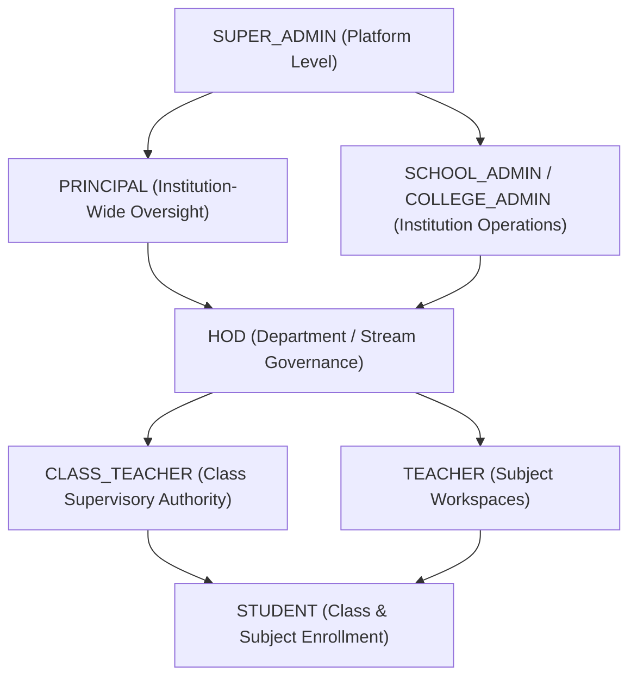

# Dashboard Role & Permission Matrix
## Multi-Tenant Role-Based Access Control Architecture

**Platform**: Nepal Digital Education Platform  
**Blueprint Reference**: KPRIET Role System  
**Enforcement**: Dual-Layer (Frontend Route & Tab Guarding + Backend Token & Mongoose Tenant Scoping)

---

## 1. Role Scope Hierarchy

---

## 2. Granular Permissions by Dashboard & Module

| Permission / Action | Super Admin | Principal | School Admin | HOD | Class Teacher | Teacher | Student |
|---|:---:|:---:|:---:|:---:|:---:|:---:|:---:|
| **Platform Provisioning & Approvals** | ✅ Full | ❌ Denied | ❌ Denied | ❌ Denied | ❌ Denied | ❌ Denied | ❌ Denied |
| **Subscription Package Assignment** | ✅ Full | ❌ Denied | ❌ Denied | ❌ Denied | ❌ Denied | ❌ Denied | ❌ Denied |
| **Central CDC Curriculum Library** | ✅ Manage | 👁️ Read | 👁️ Read | 👁️ Read | 👁️ Read | 👁️ Read | 👁️ Read |
| **Institution Settings & Emis Code** | ✅ Full | 👁️ Read | ✅ Full | ❌ Denied | ❌ Denied | ❌ Denied | ❌ Denied |
| **User & Staff Directory Management** | ✅ All | 👁️ Read | ✅ Full | 👁️ Dept | ❌ Denied | ❌ Denied | ❌ Denied |
| **Class Teacher Appointments** | ❌ Denied | ✅ Approve | ✅ Assign | 👁️ Dept | ❌ Denied | ❌ Denied | ❌ Denied |
| **Subject Allocations (Teacher -> Sec)**| ❌ Denied | 👁️ Read | ✅ Full | ✅ Dept | ❌ Denied | ❌ Denied | ❌ Denied |
| **Timetable Generation & Publishing** | ❌ Denied* | ✅ Approve | ✅ Full | 👁️ Dept | ❌ Denied | ❌ Denied | 👁️ Enrolled |
| **Daily Attendance Marking** | ❌ Denied | 👁️ School | 👁️ School | 👁️ Dept | ✅ Class Sec | ✅ Assigned Sub | 👁️ Own Only |
| **Continuous Assessment & Quiz Studio**| ❌ Denied | 👁️ School | 👁️ School | 👁️ Dept | 👁️ Class Sec | ✅ Assigned Sub | 👁️ Take Quiz |
| **Terminal Marks Entry (CDC Grades)** | ❌ Denied | 👁️ School | 👁️ School | 👁️ Dept | 👁️ Read All | ✅ Assigned Sub | 👁️ Own Only |
| **Terminal Exam Results Verification**| ❌ Denied | ✅ Sign-Off | 👁️ School | 👁️ Dept | ✅ Verify Sec | ❌ Denied | ❌ Denied |
| **Terminal Report Cards Publishing** | ❌ Denied | ✅ Final Appr | 👁️ School | 👁️ Dept | ✅ Publish Sec | ❌ Denied | 👁️ Own Only |
| **Academic Risk / Early Warnings** | ❌ Denied | 👁️ School | 👁️ School | 👁️ Dept | 👁️ Class Sec | 👁️ Assigned Sub | 👁️ Own Only |
| **Smart Board & Simulation Player** | ✅ Manage | ✅ Access | ✅ Access | ✅ Access | ✅ Access | ✅ Access | ✅ Access |

*\*Super Admin access to school timetables requires explicit opt-in setting by the School Admin.*

---

## 3. Data Isolation Rules

1. **Tenant Invariant**:
   Every query executed on behalf of an institution user (`PRINCIPAL`, `SCHOOL_ADMIN`, `HOD`, `CLASS_TEACHER`, `TEACHER`, `STUDENT`) must include `institutionId: req.user.institutionId`. Cross-institution leaks are strictly forbidden.

2. **Department Invariant**:
   HOD queries must filter by `departmentId` or matching `stream` / `programmeId`. An HOD for Science cannot modify allocations for Management.

3. **Class Teacher Invariant**:
   A Class Teacher can inspect the full all-subject mark sheet of their assigned section to compile terminal report cards, but cannot edit raw marks submitted by other subject teachers unless given explicit administrative delegation.

4. **Student Privacy Invariant**:
   Students can only access records where `studentId === req.user.userId`. They cannot view classmate grades, personal marks, or unauthorized teacher assessments.

