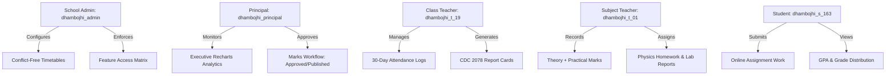

# Demonstration School Walkthrough Guide
## Dhambojhi Higher Secondary School (धम्बोझी उच्च माध्यमिक विद्यालय)

**Institution:** Dhambojhi Higher Secondary School  
**EMIS Code:** `570010001`  
**Address:** Nepalgunj, Banke, Lumbini Province, Nepal  
**Classification:** Model Community Secondary School  
**Academic Year:** 2083 BS (2083/2084)  
**Standard Demo Password:** `DemoPass123!`

---

## 1. System Overview & Architecture

Dhambojhi Higher Secondary School is a fully populated, multi-stream demonstration institution designed to showcase the complete capabilities of the Nepal Digital Education Platform across all 12 operational phases.

### Key Data Architecture
- **Curriculum Framework:** Official Nepal Curriculum Development Centre (CDC) 2078 Grading System.
- **Grades Covered:** Classes 1 through 12.
  - Grades 1–10: General Stream (Sections A & B each).
  - Grades 11–12: Science Stream (Sections A & B each).
  - Grades 11–12: Management Stream (Sections A & B each).
  - Total Classes: 14 | Total Sections: 28.
- **Student Population:** 252 enrolled fictional students (~9 per section) with unique roll numbers, admission numbers (`DH-2083-XXXX`), guardian contact records, and device availability profiles.
- **Faculty Roster:** 30 fictional teachers covering all CDC subject specializations. All 28 sections have an assigned Class Teacher.
- **Conflict-Free Timetable:** 1,176 weekly timetable slots across Sunday through Friday with zero room or teacher double-booking conflicts.
- **Assessments & Marks:** 142 assessments and 1,278 student marks records evaluated using CDC 2078 theory/practical pass rules.
- **Attendance Records:** 150 daily attendance sessions across 30 school days with realistic student attendance patterns.

---

## 2. Walkthrough by User Persona



---

### Scenario A: School Administrator (`dhambojhi_admin`)

1. **Log in as School Administrator:**
   - URL: `/login`
   - Username: `dhambojhi_admin` | Password: `DemoPass123!`
2. **Review Institution Profile:**
   - Navigate to `/admin/institution` (or School Settings).
   - Observe the pre-populated official metadata:
     - EMIS Code: `570010001`
     - Province: `Lumbini Province`, District: `Banke`, Municipality: `Nepalgunj Sub-Metropolitan City`.
     - Active Academic Year: `2083`.
     - School Timings: `10:00 - 16:00`, 45-minute periods, lunch break `13:00 - 13:45`.
3. **Inspect Timetable Master Schedule:**
   - Navigate to `/admin/timetable`.
   - Select Class: **Grade 10**, Section: **Section A**.
   - Note the conflict-free 6-period daily schedule running Sunday through Friday with designated rooms (`Room 119`).
4. **Inspect Feature Access Matrix:**
   - Navigate to `/admin/features`.
   - Observe that `FULL_DIGITAL` mode is enabled school-wide.
   - Inspect individual device profiles showing 120 personal smartphones, 60 shared devices, 35 lab computers, and 25 smartboard-only students.

---

### Scenario B: Principal Dashboard & Analytics (`dhambojhi_principal`)

1. **Log in as Principal:**
   - Username: `dhambojhi_principal` | Password: `DemoPass123!`
2. **Analyze Academic Performance:**
   - Navigate to `/principal/analytics`.
   - **Attendance Trends:** Observe institution-wide attendance rate averaging 93.4% across the last 30 school days.
   - **Grade Distribution Chart:** View interactive Recharts bar charts showing CDC 2078 distribution across A+, A, B+, B, C+, D, and NG.
   - **Class-wise Comparison:** Compare performance between Grade 10 Section A and Section B.
3. **Verify Examination & Marks Status:**
   - Navigate to `/principal/examinations`.
   - Observe 3 Examinations:
     - `First Terminal Examination 2083` — **PUBLISHED** (Weightage: 25%)
     - `Second Terminal Examination 2083` — **PUBLISHED** (Weightage: 25%)
     - `Annual Final Examination 2083` — **SCHEDULED** (Weightage: 50%)
4. **Publish School Announcements:**
   - Navigate to `/announcements`.
   - Inspect pre-seeded notices regarding the Lumbini Province Science & Robotics Exhibition.

---

### Scenario C: Class Teacher Dashboard (`dhambojhi_t_19` - Prakash Regmi)

1. **Log in as Class Teacher:**
   - Username: `dhambojhi_t_19` | Password: `DemoPass123!`
   - Prakash Regmi is the designated Class Teacher for **Grade 10, Section A**.
2. **Review Class Attendance:**
   - Navigate to `/teacher/attendance`.
   - Select Section: **Grade 10 - Section A**.
   - Review 30 days of attendance history.
   - Note high-attendance regular students (Roll 1 Aarav Chaudhary, Roll 2 Ananya Tharu) vs. Roll 9 (Saroj Adhikari) flagged for attendance intervention (<75%).
3. **Verify Subject Marks & Print Grade Sheets:**
   - Navigate to `/teacher/results`.
   - Review verified marks across all compulsory subjects (Nepali, English, Mathematics, Science & Technology, Social Studies).
   - Observe that CDC 2078 letter grades and GPAs are automatically computed.

---

### Scenario D: Subject Teacher (`dhambojhi_t_01` - Bishnu Prasad Thapa)

1. **Log in as Subject Teacher:**
   - Username: `dhambojhi_t_01` | Password: `DemoPass123!`
   - Specialization: Senior Science & Physics Faculty.
2. **Inspect Marks Entry & Verification:**
   - Navigate to `/teacher/marks`.
   - Select Examination: **First Terminal Examination 2083**.
   - Select Subject: **Compulsory Science & Technology (SCI10)**.
   - Note theory marks (out of 75, pass marks 27) and practical marks (out of 25, pass marks 10).
   - Verify that both components must satisfy CDC minimums to achieve a passing grade.
3. **Review Homework & Assignments:**
   - Navigate to `/teacher/assignments`.
   - Open assignment: *"Newton's Laws of Motion & Gravitational Fields Numerical Set"*.
   - View 5 student submissions already graded with teacher comments and scores.

---

### Scenario E: Student Learning Portal (`dhambojhi_s_163` - Aarav Chaudhary)

1. **Log in as Top Performing Student:**
   - Username: `dhambojhi_s_163` | Password: `DemoPass123!`
   - Grade 10 Section A, Roll 1 (Outstanding student, GPA 4.00).
2. **Check Terminal Report Card:**
   - Navigate to `/student/results`.
   - View official CDC 2078 First Terminal Grade-sheet:
     - Theory & Practical component breakdown.
     - Letter grades (A+ across all subjects).
     - Grade Point Average (GPA: 4.00).
     - Remarks: *"Satisfactory performance"*.
3. **View Timetable & Daily Schedule:**
   - Navigate to `/student/timetable`.
   - View daily period schedule from 10:00 to 16:00 in Room 119.
4. **Inspect Assignments & Submissions:**
   - Navigate to `/student/assignments`.
   - Inspect the graded Physics submission with teacher feedback: *"Excellent derivation and unit conversions"*.

---

### Scenario F: Remedial Student Case (`dhambojhi_s_171` - Saroj Adhikari)

1. **Log in as Remedial Student:**
   - Username: `dhambojhi_s_171` | Password: `DemoPass123!`
   - Grade 10 Section A, Roll 9.
2. **Observe Non-Graded (NG) CDC Rule:**
   - Navigate to `/student/results`.
   - In Mathematics: Theory marks = 20/75 (below CDC pass mark 27).
   - Grade is correctly marked as **NG (Non-Graded)** with GPA **0.00**, accurately illustrating CDC 2078 failing component rules.

---

## 3. Command Line Utilities & Automation

All demonstration commands are managed through `backend/package.json`:

### 1. Repeatable Seeding
Seeds Dhambojhi Higher Secondary School from scratch. Automatically executes safe tenant cleanup beforehand to ensure zero duplicate key errors.
```bash
cd backend
npm run seed:dhambojhi
```

### 2. Comprehensive Data Verification
Executes 33 relational integrity checks validating institution records, enrollments, conflict-free timetable slots, CDC 2078 mark summations, and foreign key references.
```bash
cd backend
npm run verify:dhambojhi
```

### 3. Safe Tenant-Isolated Reset
Safely removes only records matching EMIS `570010001` and demo usernames (`dhambojhi_*`). Does **not** touch Kathmandu Model Secondary School or any other school records.
```bash
cd backend
npm run reset:dhambojhi
```

---

## 4. Tenant Isolation Guarantee

The demonstration scripts strictly isolate Dhambojhi school records using targeted MongoDB filters:
- Institution EMIS Filter: `emisCode: '570010001'`
- User Pattern Filter: `/^dhambojhi_/i`
- Relational ID Scoping: All classes, sections, enrollments, timetables, assessments, marks, and attendance records are tied exclusively to `dhambojhi._id`.

Existing tenants (such as Kathmandu Model Secondary School) remain completely unaffected during seeding, verification, or reset operations.

