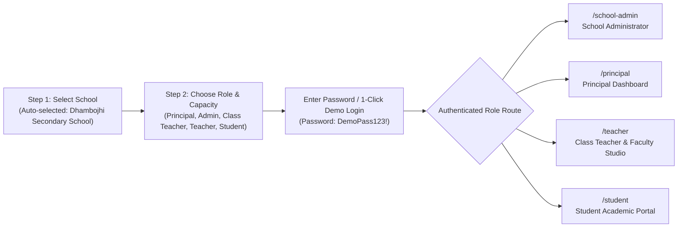

# DHAMBOJHI SECONDARY SCHOOL — USER LOGIN WORKFLOW

**Institution:** Dhambojhi Secondary School, Nepalgunj, Banke  
**Web Portals:**  
- **Public Portal & Institutional Login:** `http://localhost:3000/login`  
- **Super Admin Governance Portal:** `http://localhost:3000/super-admin-login`  
- **Interactive Home Page:** `http://localhost:3000/`

---

## 1. Two-Step Institutional Authentication Flow

The institutional login screen (`/login`) is structured into a clean, 2-step stepper designed for school multi-tenancy:

---

## 2. Step-by-Step Instructions

### Step 1: Select Institution
1. Navigate to `/login`.
2. Dhambojhi Secondary School (`EMIS: 570010001`) is pre-selected by default.
3. The school badge displays its accredited location: `Nepalgunj Sub-Metropolitan City, Banke, Lumbini Province`.
4. Click **Continue** (or press Enter) to proceed to Step 2.

### Step 2: Select Role & Authenticate
Select the role you wish to inspect:
- **Principal Login:** Pre-fills `dhambojhi_principal` / `DemoPass123!` -> Navigates to `/principal`.
- **Admin Login:** Pre-fills `dhambojhi_admin` / `DemoPass123!` -> Navigates to `/school-admin`.
- **Class Teacher Login:** Pre-fills `dhambojhi_t_18` / `DemoPass123!` -> Opens `/teacher` with Class Teacher section supervisor panel active.
- **Normal Teacher (Subject Faculty):** Pre-fills `dhambojhi_t_01` / `DemoPass123!` -> Opens `/teacher` with subject teaching allocations and CDC textbook workspace.
- **Student Login (Classes 1–12):** Click any grade pill (`Class 1` to `Class 12 Sci` or `Class 12 Mgt`) to auto-fill the test student credentials with `DemoPass123!`.

---

## 3. Alternative 1-Click Instant Demo Entry

Underneath the credential input form on Step 2, each role includes an **Instant 1-Click Demo Entry** button. Clicking this button performs automatic authentication without manually typing the password, routing directly to the appropriate dashboard.

