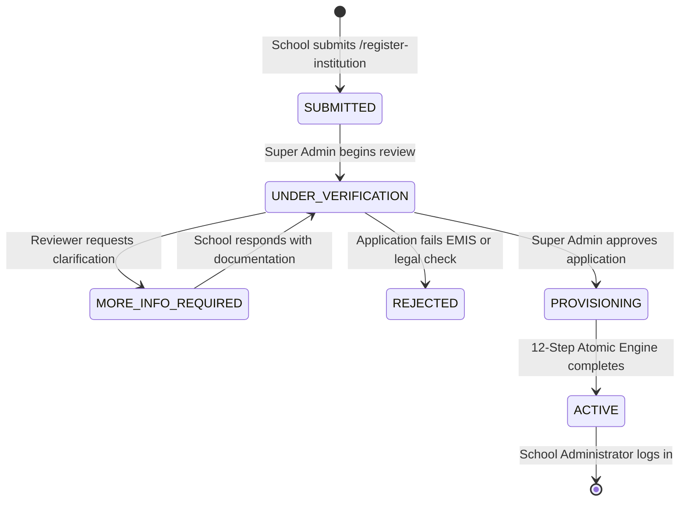

# Institution Review, Verification & Approval Workflow

## Nepal Digital Education Ecosystem (नेपाल डिजिटल शिक्षा प्रणाली)
**Target Users:** Platform Super Administrators, Ministry Education Tech Officers, Verification Auditors  
**Workflow Category:** Administrative Governance & Quality Assurance

---

## 1. Objective & Purpose
The Institution Approval Workflow establishes a rigorous, transparent review protocol for self-registered schools and colleges applying to join the national platform. It ensures that every institution on the system possesses legitimate educational credentials, accurate EMIS data, and verified administrative leadership before system resources and accounts are generated.

---

## 2. Comprehensive Workflow State Machine

---

## 3. Reviewer Verification Checklist
When a Super Admin opens an application in the **Registration Requests & Approvals** queue, they conduct a 4-point verification audit:

### Check 1: EMIS Code Verification
- Validate the 9-digit EMIS code against the official CEHRD / Ministry Master School Census.
- Ensure the EMIS code matches the physical school name and district.
- Check that the EMIS code is not already registered to another active institution on the platform.

### Check 2: Geographic & Federal Alignment
- Verify that the declared local level (Metropolitan, Sub-Metropolitan, Municipality, Rural Municipality) and Ward number exist within the specified District and Province.
- Check for physical school location plausibility.

### Check 3: Head of Institution Authorization
- Verify that the contact person is authorized (Principal, Headmaster, Campus Chief, or Management Committee Chair).
- Ensure official telephone contact and email addresses are functional.

### Check 4: Academic Program & Package Compatibility
- Verify that requested educational levels (Primary 1–5, Middle 6–8, Secondary 9–10, Higher Secondary 11–12) match the institution's official government operating approval.

---

## 4. Review Decisions & Actions

### Action A: Request More Information (`MORE_INFO_REQUIRED`)
- **When to use:** Incomplete documentation, questionable contact details, or ambiguous TVET/college streams.
- **Workflow:** Super Admin enters specific clarification notes. The system updates the status to `MORE_INFO_REQUIRED`.
- **Applicant Experience:** The school immediately sees the query on the public `/institution-registration-status` tracker and receives an email notice.

### Action B: Reject Application (`REJECTED`)
- **When to use:** Duplicate submission, unverified private organization, invalid EMIS code, or fraudulent application.
- **Workflow:** Super Admin records an official rejection reason. Status transitions to `REJECTED`.
- **Applicant Experience:** The tracking portal displays the rationale, and no database or user accounts are created.

### Action C: Approve & Provision (`APPROVED` / `ACTIVE`)
- **When to use:** All 4 verification checks pass satisfactorily.
- **Workflow:**
  1. Super Admin clicks **"Approve & Provision Now"**.
  2. Status transitions to `PROVISIONING`.
  3. The 12-step atomic engine creates the school database, academic year, classes, sections, curriculum mappings, feature settings, subscription entitlements, and administrator account.
  4. Status transitions to `APPROVED` / `ACTIVE`.
  5. Provisioned credentials and job audit log are committed.

---

## 5. Auditability & Compliance Records
Every review action (approval, rejection, or clarification request) permanently logs:
- `reviewedBy`: Super Admin user ObjectId and username.
- `reviewedAt`: Precise ISO 8601 server timestamp.
- `notes`: Official review remarks.
- `provisionedInstitutionId`: Pointer to the active institution record in MongoDB.

