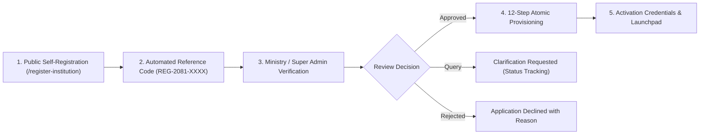

# Institutional Self-Registration & Onboarding Manual

## Nepal Digital Education Ecosystem (नेपाल डिजिटल शिक्षा प्रणाली)
**Target Users:** School Principals, Headmasters, College Administrators, Campus Chiefs, Education Officers  
**Platform Version:** 2.0 (MERN Architecture + CDC Nepal Integrated)

---

## 1. Overview & Purpose
The Nepal Digital Education Platform provides a centralized, government-standard digital operating system for schools and higher secondary colleges across all seven provinces of Nepal. Institutions may onboard through a transparent self-registration workflow that connects directly to the Central Ministry & CDC database for verification and automated provisioning.

---

## 2. Onboarding Workflow Overview


---

## 3. Step-by-Step Registration Guide

### Step 1: Institutional Classification & Identity
- **Institution Kind:** Select **School (Classes 1–12)** or **College / Higher Education**.
- **Institution Name (English):** Official registered name as per government records (e.g. *Dhambojhi Higher Secondary School*).
- **Institution Name in Devanagari (नेपाली नाम):** Official Nepali name (e.g. *धम्बोझी उच्च माध्यमिक विद्यालय*).
- **Short Name / Acronym:** 3 to 6 character abbreviation (e.g. *DHSS*).
- **Government EMIS Code:** Official 9-digit EMIS identifier issued by the Centre for Education and Human Resource Development (CEHRD).
- **Registration / Affiliation Number:** District Education Office registration or university affiliation number.
- **Classification Category:**
  - *Community / Public School (सामुदायिक विद्यालय)*
  - *Institutional / Private School (संस्थागत विद्यालय)*
  - *Religious / Gurukul / Madrasa / Gumba (धार्मिक विद्यालय)*
  - *Technical / TVET Stream (प्राविधिक शिक्षालय)*
- **Established Year:** In Bikram Sambat (B.S.) or A.D.

### Step 2: Geographic & Administrative Hierarchy
The platform uses the official federal structure of Nepal with cascading selection:
1. **Province (प्रदेश):** Select from the 7 Provinces (Koshi, Madhesh, Bagmati, Gandaki, Lumbini, Karnali, Sudurpashchim).
2. **District (जिल्ला):** Automatically filtered based on the selected province (77 total districts).
3. **Local Level (स्थानीय तह):** Automatically populated with Metropolitan Cities, Sub-Metropolitan Cities, Municipalities, or Rural Municipalities.
4. **Ward Number (वडा नं.):** Dynamic ward selector constrained to the legal ward boundaries of that local level.
5. **Tole / Street Address & Postal Code:** Physical geographic location.

### Step 3: Institutional Contact Information
- **Contact Person:** Full legal name of the institutional head (Principal, Headmaster, or Campus Chief).
- **Designation:** Official title.
- **Official Email Address:** Registered email domain or official school inbox.
- **Primary Telephone:** Landline or verified mobile number.
- **Alternative Helpline & Website:** Institutional digital presence.

### Step 4: Academic Offering & Curriculum Structure
- **Current Academic Session:** Standard Nepalese calendar year (e.g. *2081/2082*).
- **Offered Educational Levels:**
  - *Basic Education (Classes 1–5)* — CDC Primary Curriculum.
  - *Basic Education (Classes 6–8)* — CDC Middle School Curriculum.
  - *Secondary Education (Classes 9–10)* — SEE Board Curriculum.
  - *Higher Secondary Education (Classes 11–12)* — NEB Science, Management, Humanities, or Education.
- **Medium of Instruction:** Bilingual (*English & Nepali*), English Medium, or Nepali Medium.
- **Estimated Enrollment:** Planned student capacity.

### Step 5: Administrator Account Setup
- **Admin Full Name:** Personal legal name of the appointed school administrator.
- **Admin Login Username:** Unique system handle (default suggested: `admin_<emisCode>`).
- **Secure Password:** Minimum 6 characters with mixed case and numeric elements.

### Step 6: Subscription Package Selection & Dispatch
- Select requested educational packages:
  - **Foundation Package (Classes 1–5):** Digital textbooks, phonetic readers, animated basic math simulations.
  - **Middle School Package (Classes 6–8):** Interactive science experiments, 3D math geometry, online quiz suite.
  - **Secondary Package (Classes 9–12):** Comprehensive SEE/NEB preparation, virtual science lab, AI learning tutor.
- Review the application summary.
- Click **"Submit Application for Review"**.

---

## 4. Application Reference Code & Tracking
Upon submission, an official tracking reference is generated:
```
Example: REG-2081-3213
```
Institutions can track verification progress 24/7 at:
`https://nepaledu.gov.np/institution-registration-status`

### Application Status Definitions:
| Status | Meaning | Next Action |
|---|---|---|
| **SUBMITTED** | Application received in Central Registry. | Awaiting Super Admin review. |
| **UNDER_VERIFICATION** | Ministry officer is verifying EMIS and contact validity. | Processing (typically 24–48 hours). |
| **MORE_INFO_REQUIRED** | Clarification requested by reviewers. | Check notes on tracking page and reply via email. |
| **APPROVED / ACTIVE** | Application approved; institution database provisioned. | School Admin can log in immediately. |
| **REJECTED** | Application declined due to invalid EMIS or lack of accreditation. | Read rejection notes; re-apply if appropriate. |

---

## 5. First-Time Sign In & Launchpad
Once approved:
1. Visit `/login`.
2. Enter your provisioned Administrator Username (e.g. `admin_570010001`) and the password created during registration.
3. Access the **School Admin Management Dashboard**.

