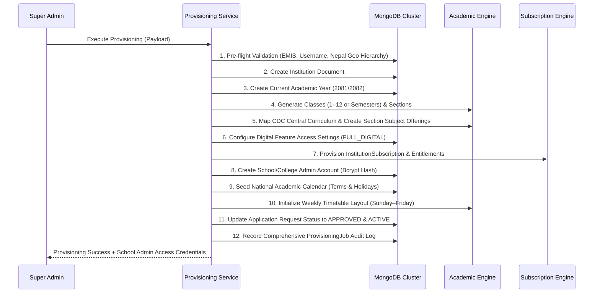

# Super Admin Institution Provisioning & Management Guide

## Nepal Digital Education Ecosystem (नेपाल डिजिटल शिक्षा प्रणाली)
**Target Users:** Platform Super Administrators, Ministry Education Tech Officers, CEHRD System Engineers  
**Access Route:** `/super-admin/*`

---

## 1. Executive Summary
The Super Admin dashboard serves as the central orchestration hub for the entire national educational platform. Super Admins possess the exclusive authority to directly provision new schools and colleges, review and verify public self-registration applications, manage commercial licenses, and audit all platform operations.

---

## 2. The 12-Step Atomic Provisioning Pipeline
When a Super Admin provisions an institution directly or approves a self-registration application, the backend executes an atomic 12-step automated sequence:

### Detailed Pipeline Breakdown:
1. **Pre-flight Validation:** Checks uniqueness of 9-digit EMIS code and admin username. Validates Province $\to$ District $\to$ Local Level hierarchy against `NEPAL_LOCATION_DATA`.
2. **Institution Record:** Creates document in `institutions` collection with coordinates, category (`COMMUNITY`, `INSTITUTIONAL`, `RELIGIOUS`, `TECHNICAL`), and timings.
3. **Academic Year Setup:** Creates `AcademicYear` document (e.g. `2081/2082`, `isCurrent: true`, Bikram Sambat start/end dates).
4. **Academic Structure Generation:**
   - **Schools:** Generates Classes 1 through 12. For each grade, generates configurable sections (`A`, `B`, `C`...).
   - **Colleges:** Generates departments and semesters (e.g. Semesters 1 through 8).
5. **Curriculum Mapping:** Queries central CDC curriculum library for matching grades, attaches compulsory and elective `SectionSubject` offerings.
6. **Feature Matrix Configuration:** Populates `InstitutionFeatureSettings` with `FULL_DIGITAL` defaults (Smart Board, Textbooks, 3D Simulations, AI Tutor, Online Submissions).
7. **Subscription & Licensing:** Binds `InstitutionSubscription` and `SubscriptionEntitlement` according to assigned package (`Foundation`, `Middle School`, `Secondary`, or `K-12 All`).
8. **Administrator Account:** Hashes password with bcrypt (10 rounds) and assigns role `SCHOOL_ADMIN` or `COLLEGE_ADMIN`.
9. **Academic Calendar Seeding:** Adds national events (Session Start, First Term Exam, Dashain/Tihar Vacation, Annual Finals).
10. **Weekly Timetable Layout:** Configures 6 periods per day, Sunday through Friday schedule.
11. **Application Linkage:** If triggered by application approval, marks `RegistrationRequest` as `APPROVED`, setting reviewer ID and timestamp.
12. **Audit Job Record:** Commits `ProvisioningJob` containing step-by-step timestamps and execution status.

---

## 3. Direct Provisioning via Dashboard Wizard
To provision a school directly without waiting for self-registration:
1. Navigate to `/super-admin`.
2. Select **Institutions Directory** in the sidebar.
3. Click the blue **"+ Register New School / College"** button.
4. Complete the 7-step wizard:
   - *Step 1: Basic Information* (School vs College, EMIS, Category, Names, Short code).
   - *Step 2: Location & Contact* (Cascading Province $\to$ District $\to$ Local Level $\to$ Ward).
   - *Step 3: Academic Configuration* (Academic session, grade levels, sections per grade).
   - *Step 4: Administrator Account* (Appointed administrator credentials).
   - *Step 5: Subscription Plan* (Package selection, quotas, validity duration).
   - *Step 6: Feature Matrix* (Enable/disable smart boards, simulations, AI assistant).
   - *Step 7: Review & Execute* (Review summary and trigger atomic provisioning).
5. The system immediately outputs the provisioned credentials and job reference code.

---

## 4. Reviewing Public Registration Requests
1. Click **Registration Requests & Approvals** in the Super Admin sidebar.
2. Filter applications by status (`SUBMITTED`, `UNDER_VERIFICATION`, `MORE_INFO_REQUIRED`, `APPROVED`, `REJECTED`).
3. Click **"Review Application"** on any request:
   - Inspect school details and duplicate check warnings.
   - **Request Clarification:** Sends questions back to the applicant school.
   - **Reject Application:** Sets status to `REJECTED` with an official explanation.
   - **Approve & Provision Now:** Triggers the 12-step atomic provisioning pipeline and activates the institution.

---

## 5. Provisioning Audit Logs & Monitoring
Click **Provisioning Audit Logs** in the sidebar to view:
- Unique Job Code (e.g. `PROV-MVZEG45S-2079`).
- Institution Name and EMIS code.
- Job Type (`DIRECT_PROVISION` vs `REQUEST_APPROVAL`).
- Status (`COMPLETED` or `FAILED`).
- Step execution breakdown (inspect timestamp and message for each of the 12 pipeline steps).

